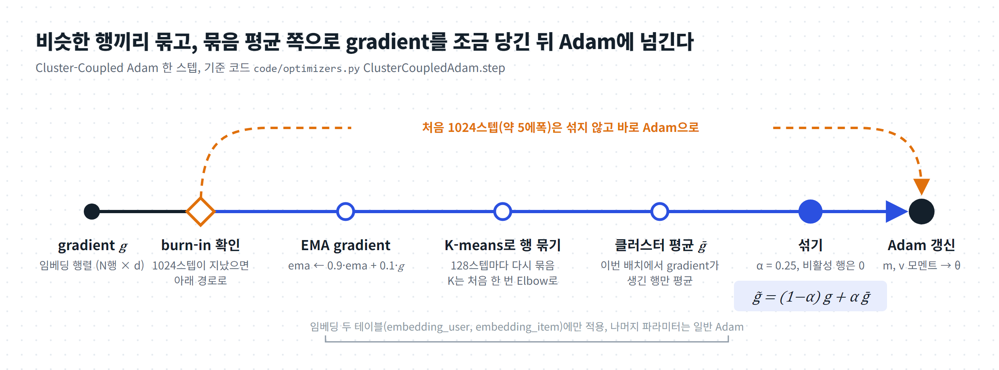
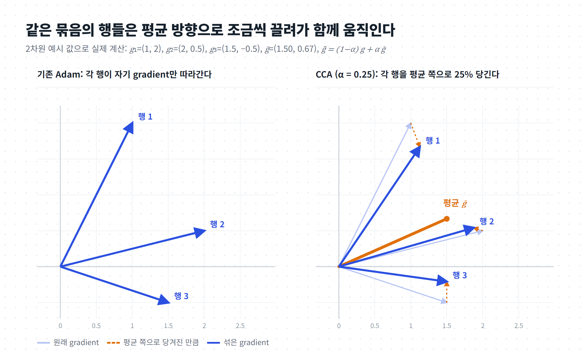
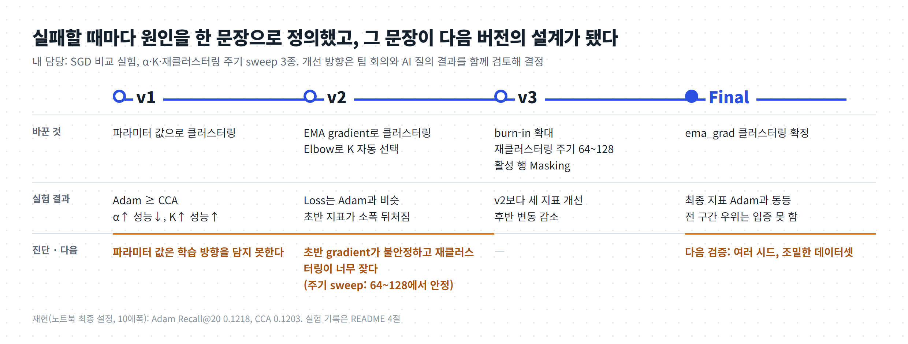
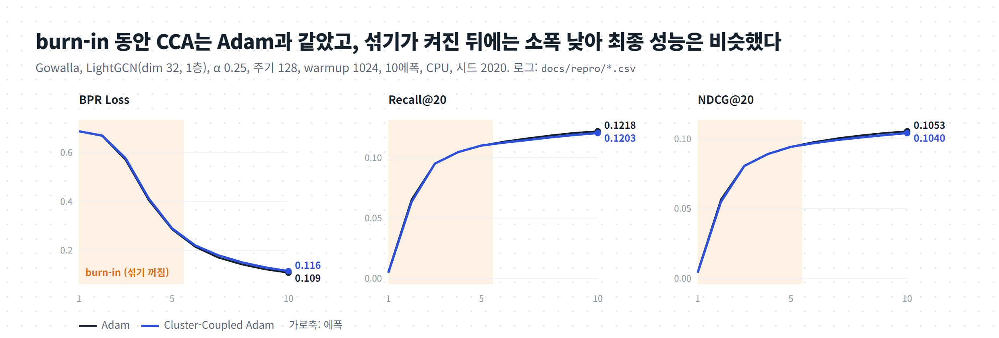
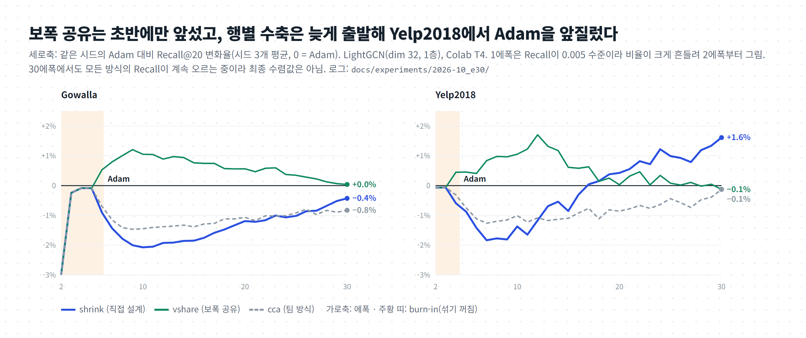

# Cluster-Coupled Adam ― 비슷한 임베딩끼리 함께 업데이트하는 추천시스템 옵티마이저

> 추천 모델(LightGCN)의 임베딩을 학습할 때, **비슷한 유저·아이템끼리 묶어서 gradient를 일부 공유**하게 만든 Adam 변형 옵티마이저를 설계하고, Adam·SGD·RMSprop·LAMB와 비교한 프로젝트입니다.
> 기간: 2025.09 – 2025.12 · 형태: 학교 수업 팀 프로젝트(5인) · **내 역할: SGD vs CCA 비교 실험, α·K·재클러스터링 주기 sweep 전부, 수식 검증 (개선 방향은 팀 회의·AI 질의로 공동 결정)**
> 이 저장소: 팀 코드(2025-12-03 시점) + 정리 문서(`docs/`) · 팀의 원래 README는 [docs/original_README.md](docs/original_README.md)

> **그림으로 먼저 보기: [00_ELI5_저장소설명.pdf](00_ELI5_저장소설명.pdf)** (4쪽, 처음 보는 사람을 위한 그림 설명. GitHub에서 바로 열림)
>
> **코드 구조 대시보드: [온라인으로 보기](https://sjzzang776.github.io/cluster-coupled-adam/dashboard/)** · [내 컴퓨터에서 보는 법](#내-컴퓨터에서-보기)

---

## 한눈에 보기

| 항목 | 내용 |
|---|---|
| 문제 | Adam 같은 기존 옵티마이저는 파라미터를 **하나씩 따로** 업데이트한다. 그런데 추천시스템에서는 비슷한 유저끼리, 비슷한 아이템끼리 강하게 연관되어 있어 비슷한 임베딩은 비슷한 방향으로 움직이는 것이 자연스럽다. |
| 아이디어 | 임베딩 행을 K-means로 묶고, 각 행의 gradient에 **같은 클러스터의 평균 gradient를 섞어서**($`\tilde g_i = (1-\alpha) g_i + \alpha \bar g_{C(i)}`$) Adam에 넣는다. |
| 개선 과정 | v1(파라미터 값으로 묶기) → v2(gradient의 EMA로 묶기 + Elbow로 K 자동 선택) → v3(Burn-in, 재클러스터링 주기 확대, 활성 행 Masking) → Final |
| 결과 | 최종 Precision·Recall·NDCG@20은 **Adam과 비슷한 수준**이며, 전 구간 우위는 입증하지 못함 (5절) |
| 데이터·모델 | Gowalla(유저 29,858 · 아이템 40,981 · 학습 상호작용 810,128 · 테스트 217,242 · 밀도 약 0.084%) · LightGCN(PyTorch 구현 기반) |
| 기술 | Python, PyTorch(`torch.optim.Optimizer` 상속), scikit-learn(KMeans), NumPy, pandas, matplotlib, TensorBoard |

---

## 1. 왜 이 문제를 골랐나

- **LightGCN**은 활성화 함수·변환 가중치 없이 유저-아이템 그래프에서 임베딩을 전파하고 평균하는 단순한 추천 모델입니다. 학습되는 것이 사실상 **임베딩뿐**이라, 임베딩을 어떻게 업데이트하는지(옵티마이저)가 성능을 크게 좌우합니다. 그래서 옵티마이저의 효과를 보기 좋은 실험대였습니다.
- 선행 연구 *Better Embeddings with Coupled Adam*(Stollenwerk & Stollenwerk)은 Adam이 드물게 등장하는 단어의 임베딩을 제대로 업데이트하지 못해 임베딩이 한쪽으로 쏠리는 문제(이방성)를 지적했습니다. 추천시스템의 롱테일 아이템도 같은 문제를 겪습니다. 여기에 *Cluster-Based Normalization* 아이디어를 더해 "비슷한 파라미터끼리 묶어서 함께 업데이트"하는 방향을 정했습니다.

## 2. 어떻게 동작하나

임베딩 테이블(유저, 아이템)마다 매 스텝 아래 순서로 갱신합니다. $`g_r`$은 행 $`r`$의 gradient, $`A`$는 이번 배치에서 gradient가 생긴 **활성 행**의 집합, $`C(r)`$는 행 $`r`$이 속한 클러스터, $`t`$는 스텝 번호입니다.

**① Burn-in.** $`t < T_{\text{warmup}}`$ (기본 1024스텝, 약 5에폭)이면 섞지 않고 $`\tilde g_r = g_r`$, 즉 일반 Adam입니다.

**② EMA gradient.** 클러스터를 묶는 기준으로 gradient의 지수이동평균을 씁니다(`cluster_source=ema_grad`, 최종 선택).

```math
e_r \leftarrow \beta_c\, e_r + (1-\beta_c)\, g_r
```

**③ 클러스터 갱신.** `recluster_interval`(128)스텝마다 $`\{e_r\}`$을 K-means로 다시 묶습니다. $`K`$는 처음 한 번만 Elbow 방법으로 $`2 \le K \le K_{\max}`$ (`num_clusters`) 안에서 고릅니다.

**④ 클러스터 평균(활성 행만).**

```math
\bar g_C = \frac{1}{|C \cap A|} \sum_{r \in C \cap A} g_r
```

**⑤ 섞기와 Masking.** 활성 행은 클러스터 평균 쪽으로 $`\alpha`$만큼 당기고, 이번 배치에 나오지 않은 행은 0으로 둡니다.

```math
\tilde g_r =
\begin{cases}
(1-\alpha)\, g_r + \alpha\, \bar g_{C(r)} & r \in A \
0 & r \notin A
\end{cases}
```

**⑥ 표준 Adam.** 섞은 gradient $`\tilde g`$로 모멘트를 갱신합니다($`\hat m, \hat v`$는 편향 보정값).

```math
m \leftarrow \beta_1 m + (1-\beta_1)\,\tilde g, \qquad
v \leftarrow \beta_2 v + (1-\beta_2)\,\tilde g^{\,2}, \qquad
\theta \leftarrow \theta - \eta\, \frac{\hat m}{\sqrt{\hat v} + \epsilon}
```

- 클러스터링은 `embedding_user`, `embedding_item`에만 적용하고 나머지 파라미터는 일반 Adam입니다(`utils.BPRLoss`).
- 손실 함수는 BPR(softplus(neg − pos)) + 0차 임베딩 L2 정규화입니다.




<sub>2차원 예시 값으로 실제 계산한 그림(α = 0.25). 같은 클러스터의 행들이 평균 방향으로 조금씩 당겨진다.</sub>

## 3. 구성 (폴더 지도)

```
25-fall-recommender/
├─ README.md, requirements.txt (torch 2.5.1, scikit-learn 1.4.2 …), notebook.ipynb (실행·시각화 예시)
├─ data/gowalla/        train.txt, test.txt, 인접행렬 캐시(.npz)
└─ code/
   ├─ main.py           학습·평가 진입점: 에폭마다 학습 → 평가 → CSV 기록
   ├─ parse.py, world.py  CLI 옵션과 전역 설정(옵티마이저, α, K, 재클러스터링 주기, warmup …)
   ├─ register.py       데이터셋·모델 등록
   ├─ dataloader.py     Gowalla 로딩, 정규화된 인접행렬 생성
   ├─ model.py          LightGCN / MF
   ├─ optimizers.py     ★ ClusterCoupledAdam (+ Cluster-Coupled SGD/RMSprop, LAMB)
   ├─ utils.py          BPRLoss(옵티마이저 선택), 평가 지표, MetricsRecorder(CSV)
   ├─ Procedure.py      BPR 학습 루프, Test(Precision/Recall/NDCG/HR, convergence_speed)
   └─ sources/sampling.cpp  선택적 C++ 네거티브 샘플러(없으면 파이썬으로 대체)
```

## 4. 개발 과정

| 단계 | 한 일 | 관찰 | 다음 결정 |
|---|---|---|---|
| Step 1 | LightGCN+Adam 베이스라인, CCA 구현, 평가 지표·로거 추가 | 정상 학습 확인 | 비교 실험 |
| Step 2 | Adam·SGD·RMSprop·LAMB·CCA 비교(50에폭) | **Adam ≥ CCA** | 왜 안 되는지 분석 |
| Step 3 | α, K, 재클러스터링 주기 sweep | α↑ → 성능↓(α=0일 때 Recall 0.1218 = Adam과 같음), K↑ → 개선(K=32 Recall 약 0.119), 주기 64~128이 안정적 | 원인 진단 → v2 |
| v2 | gradient(EMA) 기준 클러스터링, Elbow로 K 자동 | Loss는 Adam과 거의 같으나 초반 지표가 소폭 뒤처짐 | 초반 불안정 → v3 |
| v3 | Burn-in 확대, 재클러스터링 주기 확대, Masking | v2보다 초반 감소 빠르고 후반 변동 감소, Loss 약 0.03 | 최종 |
| Final | ema_grad 클러스터링 | 학습 초반 Loss가 비교군보다 빠르게 감소, 최종 지표는 Adam과 비슷 | 결론 |



**팀의 결론**: 모델이 커질수록(임베딩 차원, 층 수) CCA가 점점 나아지는 경향이 있어, 더 조밀한 데이터·큰 모델에서 유리할 가능성이 있다. 다만 이번 환경(매우 희소한 Gowalla + LightGCN)에서는 Adam과 동등한 수준이었다.

## 5. 결과

최종 설정으로 Adam과 CCA를 10에폭씩 돌린 결과입니다(Gowalla, CPU 4스레드, 시드 2020, 1에폭에 약 1분 40초). 원본 로그: [docs/repro/](docs/repro/)



| 에폭 | Loss Adam / CCA | Recall@20 Adam / CCA | NDCG@20 Adam / CCA | HR@20 Adam / CCA |
|---|---|---|---|---|
| 2 | 0.6672 / 0.6688 | 0.0654 / 0.0634 | 0.0565 / 0.0548 | 0.278 / 0.270 |
| 5 (burn-in 끝) | 0.2859 / 0.2901 | 0.1099 / 0.1100 | 0.0942 / 0.0941 | 0.425 / 0.425 |
| 6 (클러스터링 시작) | 0.2145 / 0.2204 | 0.1133 / 0.1125 | 0.0976 / 0.0968 | 0.436 / 0.433 |
| 10 | 0.1088 / 0.1156 | **0.1218** / 0.1203 | 0.1053 / 0.1040 | 0.463 / 0.458 |

**정리**
1. **최종 성능은 Adam과 비슷하다**: 10에폭 Recall@20은 Adam 0.1218, CCA 0.1203. Adam 값은 팀이 sweep에서 쓴 기준선과 같다.
2. **burn-in 구간에서는 CCA ≈ Adam**: 처음 1,024스텝(약 5.2에폭)은 클러스터링 없이 Adam과 같은 갱신을 하므로 1~5에폭 두 곡선이 거의 겹친다. 그래서 이 구간의 차이를 클러스터링 효과로 볼 수는 없다.
3. **클러스터링이 켜진 뒤(6에폭~)에는 CCA가 소폭 뒤처진다**: 10에폭 Recall −1.2%, NDCG −1.3%, HR −1.0%. α가 클수록 나빠진다는 sweep 결과와 같은 방향.
4. **실제 K**: `--num_clusters 64`는 탐색 상한일 뿐이고 Elbow가 고른 K는 **유저 15, 아이템 11**(로그 `best_K(elbow)`). K는 처음 한 번만 고르고, 재클러스터링 때는 같은 K로 다시 묶는다.
5. **HR@20 지표 오류를 고쳤다**: 원래 코드는 HR을 사용자별이 아니라 테스트 배치 단위로 세어, 모든 옵티마이저에서 약 0.0020으로 평평하게 나왔다(최댓값 = 배치 수 59 ÷ 사용자 29,858). 사용자마다 hit 여부를 세도록 `utils.HitRatio_ATk`를 고친 뒤의 값이 위 표다.


## 6. 설치와 실행

```bash
pip install -r requirements.txt          # torch 2.5.1, scikit-learn 1.4.2, tensorboardX 2.6 …
cd code                                  # ★ 데이터 경로가 ../data 기준이라 code/ 안에서 실행해야 함
python main.py --dataset gowalla --model lgn --recdim 32 --layer 1 --epochs 30 \
  --bpr_batch 4096 --testbatch 512 --optimizer cluster \
  --alpha 0.25 --num_clusters 64 --recluster_interval 128 --cluster_warmup 1024
# 비교군: --optimizer adam | sgd | rmsprop | lamb
# 결과: code/runs/logs_<dataset>_<optimizer>_lgn-<시각>.csv  (epoch, loss, precision/recall/ndcg/hr@20, convergence_speed)
```
- 자주 막히는 곳: README·노트북의 예시(`python code/main.py`)를 저장소 맨 위에서 실행하면 `../data/gowalla/train.txt`를 찾지 못합니다. `code/`로 이동해서 `python main.py`로 실행하세요.
- `cppimport`가 없으면 C++ 샘플러 대신 파이썬 샘플러를 씁니다(결과 동일, 조금 느림).
- CPU(4스레드)에서 1에폭 학습+평가에 약 1분 40초.

## 7. 한계와 다음 계획
- 팀 방식(gradient 방향 섞기)이 Adam보다 낫다는 것은 입증하지 못했다. 여러 시드·Yelp2018 확인은 아래 「후속 개선 실험」에서 했다.
- 학습 초반 Loss가 빨리 줄어드는 것처럼 보인 구간은 burn-in(순수 Adam)과 겹쳐서, 클러스터링 효과로 해석하지 않았다(5절).
- Elbow K를 재클러스터링 때마다 다시 고를지 결정.

## 8. 사용한 기술

| 분류 | 도구 |
|---|---|
| 모델·학습 | PyTorch 2.5(`Optimizer` 상속 커스텀 옵티마이저), LightGCN, BPR loss |
| 클러스터링 | scikit-learn KMeans, Elbow(직선과의 거리 최대), EMA |
| 데이터·분석 | NumPy, SciPy(희소 인접행렬), pandas, matplotlib, TensorBoard(tensorboardX) |
| 실험 관리 | argparse CLI, CSV 지표 기록(MetricsRecorder), Jupyter 노트북 |

## 후속 개선 실험 (2026-10, 프로젝트 이후 개인 진행)

팀 결과(최종 성능 Adam과 동등)의 원인을 선행 연구와 비교해 가설로 세우고, 개선안을 옵티마이저 옵션으로 넣어 같은 조건에서 비교했습니다.
**조건:** Gowalla, LightGCN(dim 32, 1층), 10에폭, CPU, 시드 2020·2021·2022 (총 27회). 아래 확인 실험(30에폭·Yelp2018)에서 결론 일부가 바뀌었습니다. 아이템을 학습 상호작용 수로 정렬해 상위 20%를 head, 나머지를 tail로 나눠 구간별 Recall@20도 쟀습니다.

| 방법 | 옵션 | 무엇을 바꾸나 | Recall@20 | NDCG@20 | head | tail |
|---|---|---|---|---|---|---|
| adam | `--optimizer adam` | 기준 | 0.1215 | 0.1046 | 0.2384 | 0.0078 |
| vshare | `--mix_mode vshare --alpha 1.0` | gradient는 그대로, 2차 모멘트(보폭)만 클러스터 평균으로 공유 | **+1.0%** | **+1.5%** | +1.7% | −9.2% |
| vwarm | `… vshare --alpha_n0 20 --alpha_freq_dir warm` | 인기 행일수록 보폭 공유 | +0.5% | +0.9% | +0.9% | −6.3% |
| vhalf | `--mix_mode vshare --alpha 0.5` | 보폭을 절반만 공유 | +0.4% | +0.6% | +0.7% | −2.3% |
| vwarm100 | `… --alpha_n0 100 --alpha_freq_dir warm` | 아주 인기 있는 행만 보폭 공유 | +0.1% | +0.5% | +0.3% | −2.8% |
| cca | `--alpha 0.25` (기본 `grad`) | 팀 방식: gradient 방향 섞기 | −1.4% | −1.4% | −1.5% | −4.7% |
| freq | `--alpha 0.5 --alpha_n0 20` | 드문 행일수록 많이 섞기 | −1.5% | −1.4% | −1.4% | −7.9% |
| dirnorm | `--mix_mode dirnorm` | 크기를 맞춘 클러스터 평균으로 섞기 | −1.7% | −1.7% | −1.8% | −4.4% |
| shrink | `--mix_mode shrink --alpha 1.0` | 행별 경험적 베이즈 수축(직접 설계, 아래) | −2.1% | −2.3% | −2.3% | −1.8% |

<sub>Adam 대비 같은 시드끼리 계산한 변화율의 평균. 모든 방법에서 시드 3개의 방향이 같았습니다. 원본 로그: [docs/experiments/2026-10_variants/](docs/experiments/2026-10_variants/)</sub>

**가설과 결과**
1. "gradient **방향**을 섞으면 행마다의 정보가 사라진다" → 섞는 방식(cca, freq, dirnorm, shrink)은 어떤 형태든 Adam보다 낮았습니다.
2. "**보폭**(2차 모멘트)만 묶으면 정보를 잃지 않는다"(Coupled Adam, SGG에서 착안) → vshare는 10에폭 시점에 시드 3개 모두에서 Adam보다 Recall·NDCG·HR이 높았습니다. 다만 30에폭에서는 차이가 사라져, 초반 수렴이 빨랐던 것으로 봅니다(아래 확인 실험).
3. "드문 행일수록 많이 공유하면 좋다"(CEL에서 착안) → 이 설정에서는 반대였습니다. freq가 tail을 가장 크게 깎았습니다.
4. 공유를 강하게 할수록 head는 오르고 tail은 떨어지는 일관된 맞바꿈이 있습니다. 드문 행은 원래 $`v`$가 작아 보폭이 큰데, 인기 행과 $`v`$를 공유하면 보폭이 줄어 덜 학습되는 것으로 봅니다.

**직접 설계한 방법: 행별 경험적 베이즈 수축 (`shrink`)**
고정된 α 대신, 각 행의 gradient를 잡음 섞인 관측으로 보고 클러스터 평균을 사전 정보로 삼아 James–Stein 방식으로 섞는 비율을 정합니다.

```math
\alpha_i = \frac{\tilde\sigma_i^2}{\tilde\sigma_i^2 + \tau_{C(i)}^2},\qquad
\tilde\sigma_i^2 = \sigma_i^2\cdot\frac{1-\beta_1}{1+\beta_1}
```

$`\sigma_i^2`$는 행 $`i`$ gradient의 스텝 간 잡음, $`\tau_C^2`$는 클러스터 안에서 행들의 평균 gradient가 서로 다른 정도입니다. 첫 버전은 한 스텝 잡음 $`\sigma_i^2`$를 그대로 써서 거의 모든 행이 $`\alpha\approx1`$로 과하게 수축했습니다(1에폭 Recall 0.0015). Adam의 모멘텀이 이미 잡음을 평균낸다는 점을 반영해 EMA 추정값의 잡음 $`\tilde\sigma_i^2`$로 고쳤습니다(0.0039). 10에폭에서는 전체 지표가 가장 낮았지만 tail 손실이 가장 작았고, 30에폭 확인 실험의 Yelp2018에서는 전체·tail 모두 Adam보다 높았습니다.

**관련 연구와의 차이**
| 연구 | 묶은 뒤 바꾸는 것 | CCA와의 관계 |
|---|---|---|
| Coupled Adam (arXiv 2502.08441) | 모든 임베딩의 2차 모멘트를 평균 | vshare는 이를 클러스터 단위로 한 것 |
| SGG (arXiv 2506.01049) | 모멘텀 K-means 후 클러스터별 학습률 배율 | 보폭을 묶는 쪽. CCA는 방향을 섞음 |
| CEL (WWW 2023, arXiv 2302.01478) | 클러스터가 임베딩 자체를 공유, gradient 주성분으로 분할 | $`\alpha=1`$에 가까운 영구 공유 |
| CB-Norm (arXiv 2403.16798) | 클러스터 평균을 빼서 정규화 | CCA는 평균 쪽으로 당김(반대 방향) |
| CoRe-GNN 등 그래프 축소 (arXiv 2608.02128) | 순전파에서 클러스터로 전파 | 순전파 섞기를 역전파하면 CCA 섞기 식과 같은 꼴 |

### 확인 실험: 30에폭 · Yelp2018 (Colab)

위 결과는 단일 데이터셋·10에폭·차이 1% 수준이라, Adam과 대표 방법 4개를 **30에폭, 데이터셋 2개(Gowalla, Yelp2018), 시드 3개**로 다시 돌렸습니다(총 30회, Colab T4, 노트북 [docs/experiments/colab_run.ipynb](docs/experiments/colab_run.ipynb)).



| 방법 | Gowalla Recall@20 | 시드별 | NDCG | tail | Yelp2018 Recall@20 | 시드별 | NDCG | tail |
|---|---|---|---|---|---|---|---|---|
| adam | 0.1362 | 기준 | 기준 | 기준 | 0.0451 | 기준 | 기준 | 기준 |
| vshare | +0.04% | −0.2 / −0.0 / +0.4 | +0.6% | −11.2% | −0.1% | −0.2 / −0.6 / +0.4 | +0.6% | −10.5% |
| vwarm | +0.1% | +0.1 / +0.0 / +0.2 | +0.5% | −7.2% | −0.4% | −0.7 / −0.7 / +0.1 | +0.3% | −6.9% |
| cca | −0.8% | −0.8 / −0.8 / −0.9 | −0.8% | −4.5% | −0.1% | −0.3 / +0.0 / −0.1 | −0.3% | +0.8% |
| **shrink** | −0.4% | −0.7 / −0.3 / −0.3 | −0.9% | **−1.8%** | **+1.6%** | **+1.3 / +1.3 / +2.3** | **+1.6%** | **+4.7%** |

<sub>30에폭 시점, Adam 대비 같은 시드끼리 계산한 변화율의 평균. 원본 로그: [docs/experiments/2026-10_e30/](docs/experiments/2026-10_e30/)</sub>

**10에폭 결론에서 바뀐 점**
1. **보폭 공유(vshare)의 +1.0%는 "초반에 빨리 오른 것"이었습니다.** 30에폭 실행의 10에폭 시점에서도 +1.05%로 같은 값이 다시 나왔지만, 이후 차이가 줄어 30에폭에서는 두 데이터셋 모두 Adam과 같은 수준(±0.1%, 시드마다 부호가 다름)이 됐습니다. Adam 최종값의 90%에 도달하는 에폭은 약 1~2에폭 빨랐습니다(Gowalla 10.3 대 11.3, Yelp2018 13.7 대 15.3). 비인기 아이템 손해(−11%)는 그대로입니다.
2. **직접 설계한 행별 수축(shrink)은 늦게 출발해 후반에 더 가파르게 올랐습니다.** Yelp2018에서는 17에폭부터 Adam을 앞섰고 30에폭에서 Recall·NDCG +1.6%, 비인기 아이템 +4.7%로 **시드 3개 모두 Adam보다 높았습니다.** 이 실험에서 전체 성능과 비인기 아이템 성능이 함께 오른 유일한 조합입니다. Gowalla에서는 아직 Adam보다 낮지만 격차가 −2.1%(10에폭)에서 −0.4%(30에폭)로 줄고 있습니다.
3. **gradient 방향을 섞는 팀 방식(cca)은** Gowalla에서 30에폭까지 시드 3개 모두 −0.8%로 낮았고, Yelp2018에서는 Adam과 거의 같았습니다.

**아직 말할 수 없는 것:** 30에폭에서도 모든 방법의 Recall이 마지막 5에폭 동안 1.4~2.9% 더 올라, 수렴한 결과가 아닙니다. shrink의 우위가 끝까지 유지되는지, Gowalla에서도 역전하는지는 더 긴 학습(LightGCN 원 논문 설정: dim 64, 3층, 수백 에폭)으로 확인해야 합니다. 이 저장소의 실험은 계산을 줄이려고 dim 32, 1층으로 작게 잡았기 때문에 Adam 기준선(Gowalla 0.136)도 원 논문 수치보다 낮습니다.

## 코드 구조 대시보드 (Understand-Anything)

**온라인으로 보기: https://sjzzang776.github.io/cluster-coupled-adam/dashboard/**

코드의 파일·함수와 그 관계를 지식 그래프로 보여 주는 대화형 화면입니다. 계층별 보기, 단계별 코드 투어, 검색, 변경 영향(Diff) 표시를 쓸 수 있습니다.
[Understand-Anything](https://github.com/Egonex-AI/Understand-Anything)(MIT) 플러그인의 대시보드를 정적 사이트로 빌드해 [`docs/dashboard/`](docs/dashboard/)에 넣었고, 그래프 원본은 `.ua/knowledge-graph.json`입니다.

### 내 컴퓨터에서 보기

**방법 1. 저장소만 받아서 보기** (Python 3만 있으면 됨)
```bash
git clone https://github.com/sjzzang776/cluster-coupled-adam.git
cd cluster-coupled-adam
python -m http.server 8000 -d docs/dashboard
# 브라우저에서 http://localhost:8000 을 연다 (끝낼 때는 터미널에서 Ctrl+C)
```
`docs/dashboard/index.html`을 더블클릭해서 열면 브라우저 보안 정책 때문에 그래프를 불러오지 못합니다. 위처럼 로컬 서버로 열어 주세요.

**방법 2. Claude Code 플러그인으로 보기** (그래프를 다시 만들거나 갱신할 때)
```text
/plugin marketplace add Egonex-AI/Understand-Anything
/plugin install understand-anything
/understand-dashboard        # 저장소 폴더에서 실행하면 .ua/knowledge-graph.json 을 읽어 대시보드를 띄움
/understand                  # 코드를 바꾼 뒤 그래프를 다시 만들 때
```

## 9. 함께 보면 좋은 문서
- [docs/01_UnderstandAnything_분석.md](docs/01_UnderstandAnything_분석.md) ― 코드 구조 지식 그래프 분석 (그래프 원본: `.ua/knowledge-graph.json`, Understand-Anything 플러그인의 `/understand-dashboard`로 열 수 있음) · Understand-Anything 플러그인이 직접 만드는 것은 `.ua/`의 JSON 그래프와 대시보드이고, 이 md는 그 결과와 플러그인 명령 결과를 사람이 읽도록 정리한 문서
- [00_ELI5_저장소설명.pdf](00_ELI5_저장소설명.pdf) ― 처음 보는 개발자를 위한 그림 설명 (원본 HTML: [docs/02_ELI5_저장소설명.html](docs/02_ELI5_저장소설명.html). GitHub은 HTML 파일을 화면으로 보여 주지 않고 소스로만 보여 주므로 PDF를 함께 둠)
- [docs/figures/make_figures.py](docs/figures/make_figures.py) ― README 그림을 만드는 코드(HTML/SVG로 그린 뒤 Edge로 PNG 저장, 스타일은 `figstyle.py`)

<sub>이 README의 그림은 모두 `docs/figures/make_figures.py`, 직접 돌린 실험, Understand-Anything으로 새로 만든 것입니다. 출처: 팀 발표 자료(5조, 텍스트·수치 참고), 팀 저장소 코드(2025-12-03 압축본), 선행 연구 *Better Embeddings with Coupled Adam*, *Cluster-Based Normalization Layer for Neural Networks*, LightGCN 원 구현(github.com/gusye1234/LightGCN-PyTorch).</sub>
