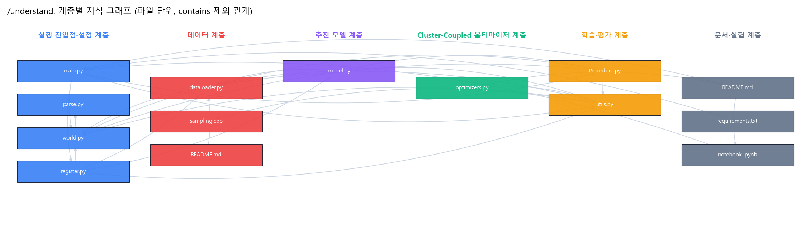
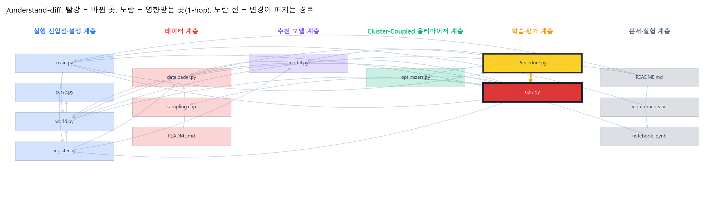

# 25-fall-recommender 구조 분석 (Understand-Anything)

> Cluster-Coupled Adam 프로젝트 코드에 Understand-Anything 가이드의 명령 1~7을 실행한 결과입니다. 8번 `/eli5`는 [02_ELI5_저장소설명.html](02_ELI5_저장소설명.html)에 있습니다.
> 실행일: 2026-10-18

## 0. 어떻게 실행했나

| 항목 | 내용 |
|---|---|
| 분석 대상 | 팀 저장소 압축본(2025-12-03)의 코드·문서 14개: `code/*.py` 9개, `code/sources/sampling.cpp`, `notebook.ipynb`, `README.md`, `requirements.txt`, `data/gowalla/README.md`. 데이터 파일(train/test/인접행렬)은 제외 |
| 방법 | **Understand-Anything 플러그인 v2.9.7 실행(방법 A)**. 플러그인의 스캔·묶음·병합·지문 스크립트와 전문 에이전트(project-scanner, file-analyzer ×3, assemble-reviewer, architecture-analyzer, tour-builder)가 Phase 1~7을 수행. `--language ko` |
| 실행 위치 | 이 저장소의 코드·문서와 **같은 파일**(SHA-1 일치 확인)로 만든 임시 git 스냅샷에서 실행한 뒤, 결과를 이 저장소의 `.ua/`로 옮김 |
| 산출물 | `.ua/knowledge-graph.json`(플러그인 스키마, `/understand-dashboard`로 열 수 있음), `.ua/diff-overlay.json`, `docs/ua/ua_results.json`, `docs/img/ua_*.png` |
| 명령 2~7 | 플러그인 각 명령의 절차(그래프 검색 → 1-hop 연결 → 계층 확인 → 원본 코드 대조)를 따라 수행. diff·그림은 project-summary 스킬의 `ua_commands.py` |

---

## 1. `/understand --language ko`

| 결과 | 값 |
|---|---|
| 파일 | 14개 (코드 11, 문서 3) · Python 9, C++ 1, Notebook 1, Markdown 2, txt 1 |
| 노드 | **52개** = 파일 11 · 함수 24 · 클래스 14 · 문서 3 |
| 엣지 | **138개** = contains 38 · exports 36 · calls 24 · imports 20 · depends_on 8 · inherits 5 · related 3 · documents 3 · configures 1 |
| 계층 | 6개 |
| 투어 | 9단계 |
| 검증 | 문제 0 · 경고 0 (조립 검토에서 소스 확인으로 `utils.py → sampling.cpp:set_seed` 호출 1개 추가) |



### 아키텍처 계층

| 계층 | 파일 | 역할 |
|---|---|---|
| 실행 진입점·설정 | main.py, parse.py, world.py, register.py | CLI 인자 → 전역 config, 데이터셋·모델 등록, 에폭 루프 |
| 데이터 | dataloader.py, sources/sampling.cpp, data/gowalla/README.md | Gowalla 로딩, 정규화 인접행렬, 네거티브 샘플링 |
| 추천 모델 | model.py | LightGCN(그래프 전파 후 층 평균), PureMF, BPR loss |
| **Cluster-Coupled 옵티마이저** | optimizers.py | ClusterCoupledAdam/SGD/RMSProp, Lamb |
| 학습·평가 | Procedure.py, utils.py | 학습 루프, BPRLoss(옵티마이저 선택), 평가 지표, CSV 기록 |
| 문서·실험 | README.md, requirements.txt, notebook.ipynb | 실행 방법, 의존성, 결과 시각화 |

### 도메인 흐름 (한 번의 실험이 지나가는 길)
```
CLI 인자(parse) → config(world) → Gowalla 로딩·인접행렬(dataloader, register)
→ LightGCN 생성(model) → BPRLoss가 옵티마이저 선택(utils) ─ cluster면 임베딩 2개만 ClusterCoupledAdam 그룹
→ 에폭마다 BPR_train_original(Procedure): 샘플링 → loss → opt.step()
→ Test(Procedure): Precision·Recall·NDCG·HR@20, convergence_speed → MetricsRecorder CSV(utils)
```

### 설계 개념
- **파라미터 그룹 분리**: 클러스터링은 `embedding_user`, `embedding_item`에만, 나머지는 일반 Adam(`BPRLoss`).
- **커스텀 옵티마이저 패턴**: `torch.optim.Optimizer` 상속, 파라미터별 `self.state`에 모멘트·클러스터 할당·EMA를 저장.
- **CLI로 실험 통제**: α, K(상한), 재클러스터링 주기, warmup, 클러스터 기준을 인자로 바꿔 sweep.
- **결과는 CSV로 남기고 노트북에서 비교 그래프**: 실험 재현성과 비교의 기반.

---

## 2. `/understand-knowledge` ― 문서·지식 관계

저장소 안의 문서는 README 2개와 requirements뿐이라(서로 링크·공유 개념 0개, 모두 고립) 문서끼리의 관계망은 의미가 없었습니다.
그래서 이 프로젝트의 진짜 지식 원천인 **발표 자료(32쪽)의 주장**을 지식 노드로 보고, 각 주장을 코드 노드와 연결해 근거가 있는지 확인했습니다. 이것이 제 역할(수식 검증)과 직접 이어집니다.

| 발표의 주장(쪽) | 연결된 코드 노드 | 근거 |
|---|---|---|
| 섞은 gradient \( (1-\alpha)g_i+\alpha\bar g_{C(i)} \) (p5, 9, 17) | `ClusterCoupledAdam.step` | 있음, 일치 |
| 클러스터 평균 \( \frac1{\lvert C\rvert}\sum g_i \) (p9, 17) | 같은 함수의 Masking 구간 | **최종 코드는 활성 행 평균**(수식 갱신 필요) |
| Elbow로 최적 K (p18) | `_find_best_k_elbow` | 있음, 일치 |
| "epoch마다 최적 K 선택" (p22) | `_update_clusters`의 `state["best_K"]` | **처음 한 번만 계산**(주장과 다름) |
| Burn-in으로 초반 Adam만 사용 (p15, 24) | `cluster_start_step` ← `--cluster_warmup` | 있음. 1024스텝 ≈ 5.2에폭 |
| Masking으로 학습 대상 아닌 개체 제외 (p24) | `active_mask` | 있음, 일치 |
| 최종 CCA 초반 Loss 우세 (p28) | burn-in 구간 = 순수 Adam | **노트북 설정으로 재현 안 됨**: 1~5에폭 CCA≈Adam, 6에폭 이후 CCA 소폭 낮음(README 6절) |
| HR@20 비교 그래프 (p20, 25, 28) | `HitRatio_ATk` | **지표 구현 오류**(배치 단위 계산) |
| 모델이 클수록 CCA 유리 (p29) | (해당 실험 코드·로그 없음) | 압축본에서 확인 불가 |

---

## 3. `/understand-explain code/optimizers.py`

> 연결이 가장 많고 복잡도 "complex"인 핵심 파일입니다. 계층: Cluster-Coupled 옵티마이저.

**안에 있는 것**

| 구성 | 하는 일 |
|---|---|
| `ClusterCoupledAdam` | 최종 제안 옵티마이저. 아래 메서드들로 동작 |
| `├ _find_best_k_elbow(w2d, 2, k_max)` | K=2…k_max로 K-means를 돌려 inertia 곡선을 얻고, 양 끝점을 잇는 직선에서 가장 먼 K를 고름 |
| `├ _update_clusters(base, state, …)` | 첫 호출이나 `recluster_interval`마다 K-means로 행을 다시 묶음. K는 처음 한 번만 Elbow로 계산해 `state["best_K"]`에 저장 |
| `└ step()` | ① weight decay ② (clustered이고 burn-in 이후) 클러스터 기준 텐서 선택(param/grad/ema_grad) → 할당 갱신 → 활성 행만으로 클러스터 평균 → 섞기 → 비활성 행 0 ③ 표준 Adam 모멘트·편향 보정·갱신 |
| `ClusterCoupledSGD`, `ClusterCoupledRMSProp` | 초기 버전 계열. 파라미터 값으로만 묶고, burn-in·Masking 없음 |
| `Lamb` | 비교군. 층별 trust ratio(‖w‖/‖update‖)로 보폭 조정 |

**연결**: `utils.BPRLoss`가 옵티마이저를 생성(calls), `utils.py`가 import, `README.md`가 설명(documents). 이 파일은 프로젝트 내부 모듈을 import하지 않는 **독립 모듈**이라 다른 모델에도 그대로 붙일 수 있습니다.

**데이터 흐름 (임베딩 테이블 하나, 한 스텝)**
`grad (N×d)` → [burn-in 이후] `ema = 0.9·ema + 0.1·grad` → (주기마다) `KMeans(best_K).fit_predict(ema)` → `assignments (N)` → `scatter_add_`로 클러스터별 gradient 합 ÷ 활성 행 수 → `mixed = (1−α)·g + α·평균[assignments]` → `× active_mask` → Adam 갱신

**막힐 만한 곳**
- `assignments`, `best_K`, `ema_grad`가 **파라미터별 `self.state`**에 들어 있어서, 유저 테이블과 아이템 테이블은 서로 다른 클러스터와 다른 K를 갖습니다.
- K-means는 `cpu().numpy()`로 옮겨서 돌립니다. GPU에서도 재클러스터링 때마다 CPU 왕복이 생깁니다.
- `--num_clusters`는 "K"가 아니라 **Elbow 탐색의 상한**입니다. 실제 K는 로그의 `best_K(elbow)=`로 확인해야 합니다.

---

## 4. `/understand-diff` ― 변경 영향도

실제 미반영 변경이 없어, 수식 검증에서 찾은 **HR@20 버그 수정**을 스냅샷에 적용해 분석했습니다. 이후 같은 수정을 저장소 코드에 반영하고 다시 실행했습니다(2026-10-18, README 6절).

```diff
 def HitRatio_ATk(ground_true, ranked, k):
-    return 1.0 if np.sum(ranked[:k]) > 0 else 0.0
+    return float(np.sum(ranked[:, :k].sum(1) > 0))   # 사용자마다 상위 k 안에 정답이 있으면 1, 그 합
```
수정 확인: 사용자 3명 예시에서 기존 함수는 배치 전체로 1을, 수정한 함수는 정답이 상위 2개에 든 사용자 수 1을 반환 → HR@2 = 1/3.



| 구분 | 결과 |
|---|---|
| 바뀐 곳 | `utils.HitRatio_ATk` (simple) |
| 영향받는 곳(1-hop) | `Procedure.test_one_batch`(호출), `utils.py` |
| 걸친 계층 | 학습·평가 1개 |
| 위험도(코드) | **낮음**: 반환형이 같고 호출부(`hr.append(...)`, 이후 사용자 수로 나눔)는 그대로 맞음 |
| **그래프 밖의 영향** | 이미 남긴 모든 CSV의 `hr@20` 열과 발표 그래프의 HR 해석이 바뀜(약 0.002 → 실제 사용자 비율). 노트북의 `plot_metrics`, 발표 자료 p20·25·28을 다시 그려야 함 |

> 첫 분석에서는 한 줄 수정에도 `utils.py` 파일 전체를 "바뀐 곳"으로 보아 영향 범위가 6개 계층 중 5개로 부풀고 위험도가 "높음"으로 나왔습니다. 변경 줄을 감싸는 가장 안쪽 함수만 보도록 스크립트를 고친 뒤 위 결과가 나왔습니다(project-summary 학습 로그에 기록).

---

## 5. `/understand-onboard` ― 새 팀원 가이드

### 읽는 순서 (플러그인 tour-builder 결과)
| 단계 | 제목 | 볼 것 |
|---|---|---|
| 1 | 프로젝트 개요 | README.md, requirements.txt |
| 2 | 실행 진입점과 전역 설정 | main.py, parse.py, world.py |
| 3 | 데이터셋과 정규화 그래프 | register.py, dataloader.py |
| 4 | LightGCN 추천 모델 | model.py (`computer`) |
| 5 | BPR 학습 루프와 샘플링 | Procedure.BPR_train_original, sampling.cpp |
| 6 | BPRLoss: 옵티마이저 선택 지점 | utils.BPRLoss |
| 7 | **핵심 아이디어: Cluster-Coupled Adam** | optimizers.ClusterCoupledAdam (`Optimizer` 상속, `self.state`, `@torch.no_grad`, `scatter_add_`) |
| 8 | 비교용 옵티마이저 변형 | ClusterCoupledSGD/RMSProp, Lamb |
| 9 | 평가 지표와 실험 기록 | Procedure.Test, MetricsRecorder, notebook (HR 경고 포함) |

### 복잡도 상위
| 복잡도 | 파일 | 이유 |
|---|---|---|
| complex | utils.py | 옵티마이저 선택, 샘플링, 지표, 로거가 한 파일 |
| complex | optimizers.py | 클러스터링·Elbow·Masking·Adam이 한 `step` 안에 |
| complex | dataloader.py | 희소 인접행렬 생성·캐시 |
| complex | Procedure.py | 학습 루프 + 평가 + convergence_speed |

### 처음 온 사람이 알아야 할 것
- `code/` 안에서 실행해야 합니다(데이터 경로가 `../data`). README 예시대로 저장소 맨 위에서 실행하면 실패합니다.
- 실험 결과는 `code/runs/*.csv`. HR@20 열은 2026-10-18 수정 이후 로그부터 믿을 수 있습니다.
- 새 옵티마이저를 추가하려면 `optimizers.py`에 클래스, `utils.BPRLoss`에 분기, `parse.py` choices에 이름을 넣으면 됩니다.

---

## 6. `/understand-chat`

**Q1. 클러스터 평균 gradient는 어디서 계산되고, 어떤 파라미터에만 적용되나?**
1. 생성: `utils.BPRLoss`가 `--optimizer cluster`일 때 이름에 `embedding_user`/`embedding_item`이 들어간 파라미터만 `clustered=True` 그룹으로 묶음 (BPRLoss → ClusterCoupledAdam, calls).
2. 계산: `ClusterCoupledAdam.step`에서 `gc_sum.scatter_add_`로 클러스터별 합, `gc_count`(활성 행 수)로 나눠 평균.
3. 적용: 그 두 임베딩 테이블에만. LightGCN에는 그 밖의 학습 파라미터가 사실상 없어 실질적으로 모델 전체에 적용됨.
4. 관련 계층: 학습·평가 → 옵티마이저.

**Q2. 발표의 convergence_speed는 무엇을 잰 것인가?**
`Procedure.Test` 안에서 (이번 Recall@20 − 직전 평가 Recall@20) ÷ 에폭 간격. 그래서 "수렴 속도"라기보다 **에폭당 Recall 증가량**이고, 초반에 크게 튀었다가 0 근처로 가는 모양이 정상입니다.

---

## 7. Language Concepts

| 패턴 | 어디에 | 이 문맥에서 왜 썼나 |
|---|---|---|
| `torch.optim.Optimizer` 상속 | optimizers.py 4개 클래스 | `param_groups`·`state`·`zero_grad` 같은 표준 동작을 그대로 쓰고 `step`만 새로 작성 |
| 파라미터별 상태 `self.state[p]` | ClusterCoupledAdam | 테이블마다 모멘트, 클러스터 할당, best_K, EMA를 따로 기억 |
| `@torch.no_grad()` | `step`, `_update_clusters` | 갱신 계산이 계산 그래프에 기록되지 않게(메모리·속도) |
| 제자리 연산(`mul_`, `add_`, `addcdiv_`) | Adam 갱신 | 새 텐서를 만들지 않고 상태·파라미터를 직접 수정 |
| `scatter_add_` + `bincount` | 클러스터 평균 | 반복문 없이 그룹별 합을 한 번에(벡터화) |
| 브로드캐스트 마스크 | `active_mask (N×1)` | 이번 배치에서 gradient가 없는 행을 0으로 유지 |
| 파라미터 그룹 옵션(`group.get(...)`) | BPRLoss → 옵티마이저 | 같은 옵티마이저 안에서 임베딩만 다른 규칙 적용 |
| 클래스 상속(BasicModel → LightGCN) | model.py | 모델을 갈아 끼워도 학습 코드는 그대로 |
| 선택적 C++ 확장(cppimport + pybind11) | sampling.cpp, utils.py | 느린 네거티브 샘플링을 C++로, 실패하면 파이썬 대체 |
| argparse 별칭 | parse.py `--alpha` → `cluster_alpha` | 노트북과 CLI 이름이 달라도 같은 설정으로 |

---

## 8. 이력서·포트폴리오 관점에서 얻은 것
- **그림**: 계층 그래프(`ua_graph_layers.png`)는 "실험 코드 구조", diff 오버레이는 "지표 버그 수정의 영향 범위" 장표에 바로 사용 가능.
- **수식 검증 에피소드**: 발표의 주장 9개를 코드와 대조해 일치 5, 수정 필요 4(클러스터 평균 수식, K 갱신 시점, HR 지표, 초반 우세 근거)를 찾음 → "AI 결과·팀 산출물을 검증하는 사람" 근거.
- **개선 후보**: HR 수정 후 재평가, best_K 주기적 재선택 실험, burn-in 길이와 초반 Loss 관계 확인, 여러 시드 반복.
